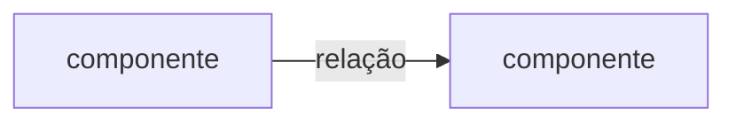

# Título curto

> Guia: apague este bloco e os outros blocos Guia ao preencher.
>
> Use quando a escolha for difícil de reverter, houver mais de uma opção com trade-off real, ou a decisão for revisitada sem registro.
>
> Não use para proposta ainda em deliberação (isso é RFC), detalhe de implementação, escolha fácil de desfazer, ou regra que já está escrita em outro lugar.
>
> Uma decisão por arquivo. Aceita, não se edita. Mudança de rumo é um ADR novo.
>
> Frontmatter obrigatório: `status` (`proposed`, `accepted`, `rejected`, `superseded`) e `date`. Opcional, só na sucessão: `supersedes` e `superseded_by`, com o nome do arquivo. Sem `type`, `id`, `version`, `tags` ou `related_docs`. O nome do arquivo é o id. O link fica em Referências.
>
> Fontes da forma: Nygard, *Documenting Architecture Decisions*; MADR; Zimmermann.

## 1. Contexto

### 1.1. Situação atual

O ponto de partida, em dois ou três parágrafos. O problema é do sistema, não de um caso solto.

### 1.2. Problema

A pergunta que esta decisão responde. Específica: definir X para Y, não "melhorar Z".

### 1.3. Drivers

- **Driver:** o que empurra a escolha, e o impacto.

### 1.4. Constraints

- Restrição que não se negocia.

## 2. Decisão

Decidimos X porque Y, aceitando Z.

Um ou dois parágrafos do porquê. A implementação fica no código.

> Guia: se a decisão tem forma, o Mermaid vem aqui, antes da prosa. Confira o render. Sem ASCII art. Apague este bloco se não houver diagrama.

## 3. Opções consideradas

> Guia: no mínimo duas opções, com o que foi rejeitado e por quê. Sem isso, a próxima leitura refaz a mesma avaliação. "Não fazer nada" entra quando for uma opção real.

### 3.1. Opção A: nome

Descrição em duas ou três frases.

| Prós | Contras |
|---|---|
| Pró | Contra |

**Adotada** ou **rejeitada**, porque a razão é concreta.

### 3.2. Opção B: nome

Descrição em duas ou três frases.

| Prós | Contras |
|---|---|
| Pró | Contra |

**Adotada** ou **rejeitada**, porque a razão é concreta.

## 4. Trade-offs aceitos

| Trade-off | Impacto | Mitigação |
|---|---|---|
| O que se aceita | Consequência concreta | Como se limita |

## 5. Consequências

### 5.1. Positivas

- O que passa a valer.

### 5.2. Negativas

- O custo que permanece.

## 6. Referências

- ADR anterior, se houver: `adr-nnn-titulo.md`.
- RFC que originou esta decisão, se houver.
- Fonte externa.
